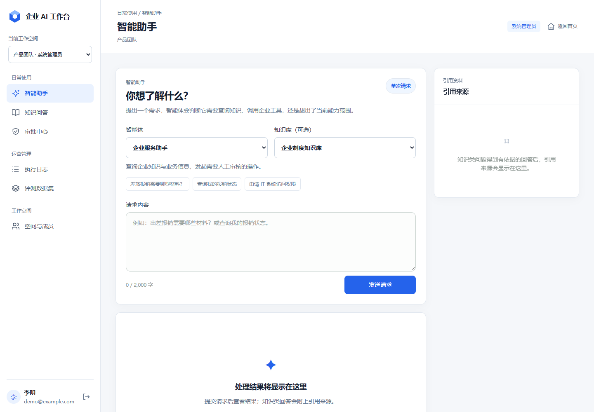
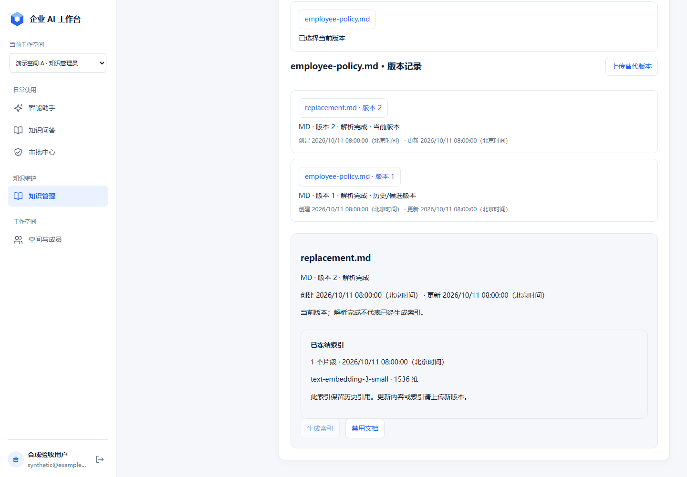
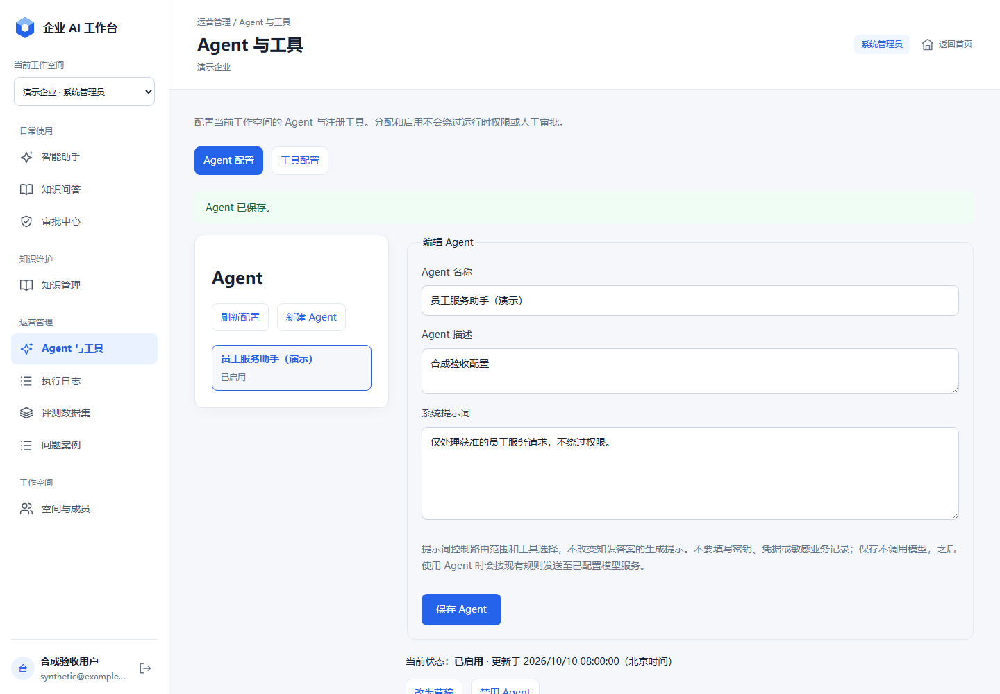
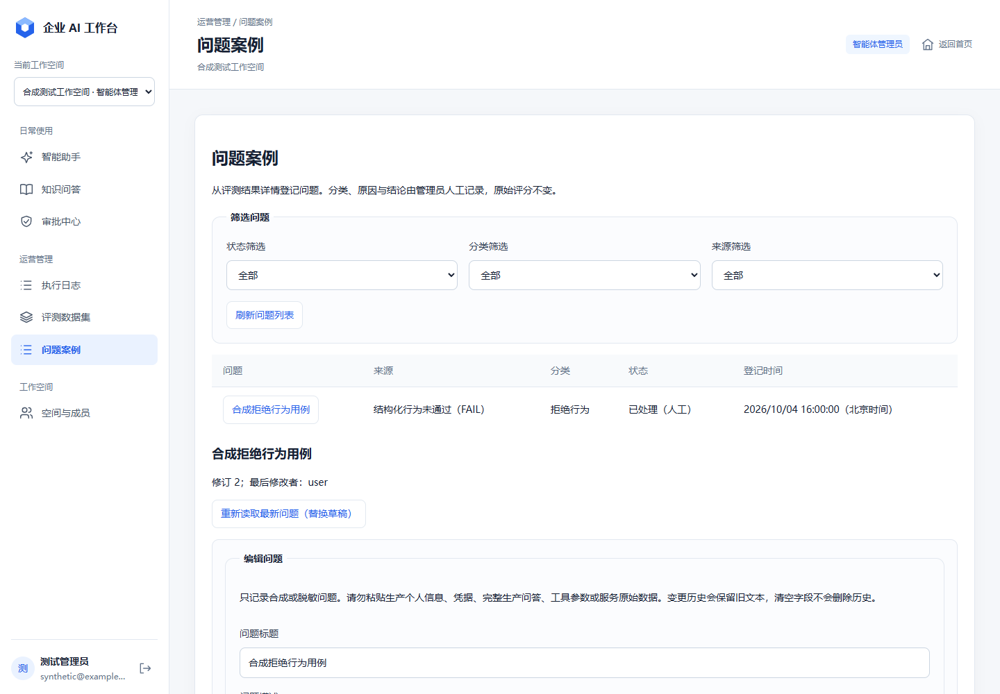
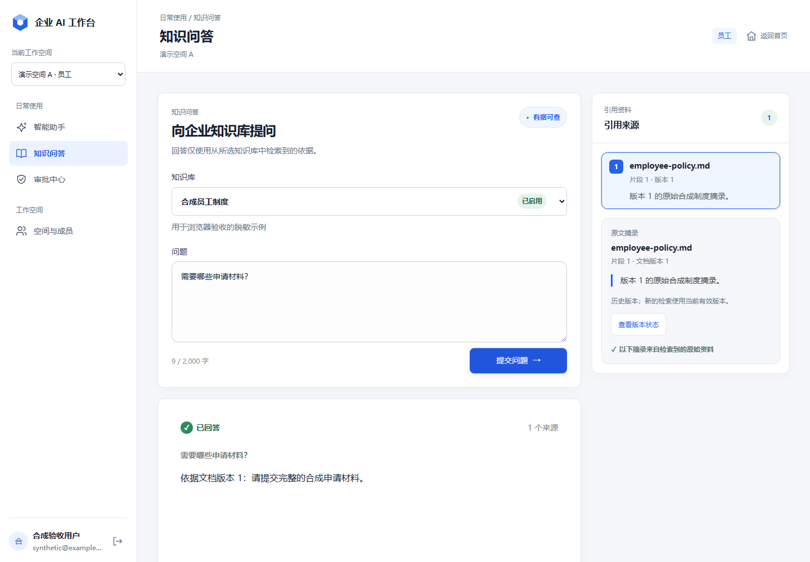
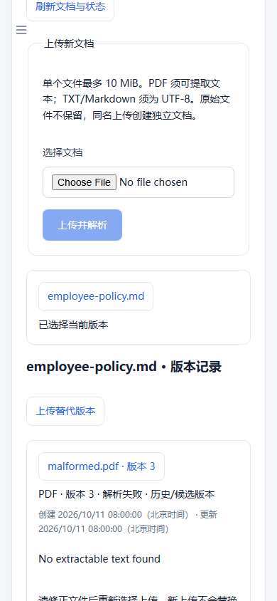
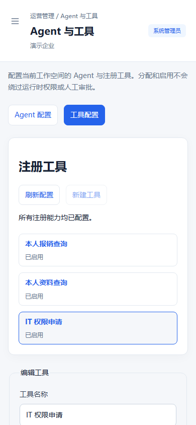
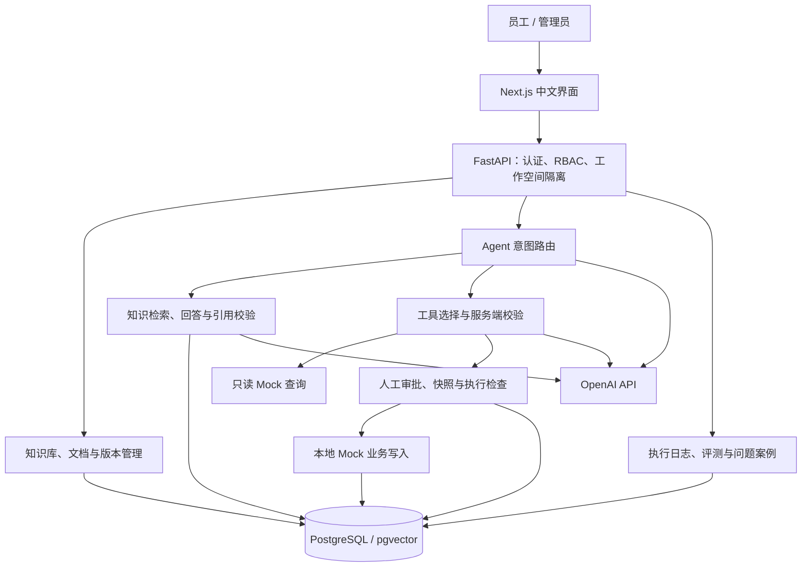

# Enterprise AI Workbench · 企业 AI 工作台

面向企业内部员工服务的 AI 工作台，将**知识问答、业务工具、人工审批与质量运营**连接到同一个工作空间。

员工可以查询制度、了解业务状态、发起访问申请；管理员可以维护知识与文档版本、配置 Agent 和工具、审批敏感操作，并通过执行日志、评测和问题案例持续改进服务质量。

项目采用 Next.js + FastAPI + PostgreSQL / pgvector，提供简体中文界面、桌面与移动端布局，以及以工作空间为边界的后端权限控制。

[功能介绍](#功能介绍) · [界面预览](#界面预览) · [技术架构](#技术架构) · [本地运行](#本地运行) · [演示指南](#演示指南) · [测试与验证](#测试与验证)



## 项目解决什么问题

企业员工完成一次日常任务，往往需要先查制度，再查询业务系统，最后找人审批。Enterprise AI Workbench 把这些环节放在统一入口，同时让每一步都有明确的权限边界、来源依据和处理结果。

| 员工需求 | 工作台的处理方式 |
|---|---|
| “出差报销需要哪些材料？” | 从所选知识库检索有效文档，生成有依据的回答，展示原文摘录与文档版本 |
| “查询我的报销状态。” | 识别业务查询意图，通过已分配的只读工具返回当前用户的业务结果 |
| “申请生产数据库只读权限，使用 7 天，用于排查问题。” | 校验申请参数，生成待审批记录，由另一位有权限的系统管理员审核后执行 |
| “这次回答或工具选择有问题，如何跟踪？” | 从评测结果建立问题案例，记录分类、可能原因、处理状态与变更历史 |

业务查询和访问申请使用项目内置的 **Mock 企业系统适配器**，便于本地复现完整流程。审批后的访问申请会写入本地模拟业务记录。

## 功能介绍

### 工作空间与角色权限

- 邮箱与密码登录，Argon2id 密码哈希，30 分钟 JWT 访问令牌。
- 一个用户可以加入多个工作空间，并在不同空间拥有不同角色。
- 工作空间切换、成员列表、添加已有用户、调整角色与成员状态。
- 后端在每次请求中校验当前用户、工作空间、Membership 与资源归属；数据库通过复合外键约束关键资源的空间一致性。
- 浏览器仅在内存中保存访问令牌，退出登录或认证失效时清理会话。

### 知识库、文档与版本管理

- 创建、编辑、启用和禁用知识库。
- 上传可提取文本的 PDF、UTF-8 TXT、Markdown，单文件上限 **10 MiB**。
- 查看文档解析状态、失败信息、索引模型、片段数量和索引时间。
- 显式生成向量索引；解析完成与可检索状态分别展示。
- 同一逻辑文档可上传替代版本，完成解析与索引后由管理员明确激活，也可切换回符合条件的历史版本。
- 替代版本准备失败时保留原当前版本；首次成功的内容与完整索引冻结，重复索引复用已有结果。
- 新检索使用当前有效版本，历史引用继续关联原文档版本与片段。

### 有来源的知识问答

- 通过 pgvector 对授权知识库进行语义检索，使用 `text-embedding-3-small` 的 1,536 维向量。
- 使用检索到的前 5 个片段作为回答依据；证据不足时返回明确的无法回答结果。
- 引用由后端从实际检索证据中解析和校验，展示文件名、文档版本、片段位置和原文摘录。
- 引用面板支持查看来源，以及显式查询该版本的当前／历史状态。
- 独立知识问答入口与 Agent 的知识路径共用检索和回答服务。

### Agent 配置与工具调用

- 通过中文管理界面创建、编辑 Agent 名称、说明、系统提示词和启用状态。
- 将请求分为知识问答、工具请求或超出能力范围，并展示对应结果。
- 管理工作空间内的工具配置，为 Agent 分配或解除工具。
- 模型提出工具与参数，后端再校验工具启用状态、分配关系、参数、身份和风险等级。

| 内置工具 | 注册标识 | 执行方式 |
|---|---|---|
| 查询我的报销状态 | `get_reimbursement_status` | 低风险，只读 Mock 查询 |
| 查询我的员工信息 | `get_employee_information` | 低风险，只读 Mock 查询 |
| 创建 IT 访问申请 | `create_it_access_request` | 高风险，人工审批后写入本地 Mock 记录 |

可执行能力、参数结构和风险等级由后端注册表定义，管理配置通过已注册能力生效。

### 人工审批与执行追踪

- 敏感工具请求生成待审批记录，保留服务端不可变执行快照。
- 同一工作空间的系统管理员可以审批或拒绝他人的申请；申请人不能自批。
- 执行前重新检查权限、配置与分配状态，发现漂移时使审批失效。
- 每条审批至多产生一次业务写入，分别保留审批决定与执行结果。
- 执行日志支持列表、筛选与详情，记录操作类型、相关对象、结果、耗时和安全化错误类别。
- 通用日志仅保留允许的元数据；审批记录保留敏感操作的权威审计事实。

### 评测与问题案例管理

- 管理评测数据集与用例，覆盖知识问答、工具调用、权限边界、拒绝行为四类场景。
- 每次同步执行一个数据集的 **1–5 条有效用例**，保留用例、配置和结构化结果快照。
- 查看整体及分类通过率、错误数、评测覆盖率、路由匹配、工具规划匹配、权限策略、拒答、引用要求与时延指标。
- 工具评测使用 **dry run**，验证选择与预期执行路径；权限用例通过共享策略函数验证预设事实。
- 从已结束的评测结果建立问题案例，区分行为失败、执行错误和人工复核。
- 记录问题分类、可能原因、处理备注、解决说明与状态，保留原始评测证据和逐次变更历史。

评测指标按结构化预期计算，回答内容的事实正确性可结合基准中的人工复核材料检查。

## 界面预览

界面采用统一蓝白配色，按日常使用、知识维护、运营管理和工作空间分组导航。管理入口随当前角色显示，移动端提供抽屉导航。

### 知识管理与文档版本



### Agent 与工具配置



### 评测问题追踪



<details>
<summary>查看历史引用与移动端界面</summary>






</details>

以上图片来自仓库内的界面验收记录，使用合成演示数据；智能助手截图展示该页面的基础布局。

## 技术架构



FastAPI 是业务与 AI 执行的控制层，负责鉴权、资源归属、工具执行和审批。前端通过 HTTP API 访问业务能力；模型调用统一在后端进行。

| 层次 | 技术与职责 |
|---|---|
| 前端 | Next.js 16、React 19、TypeScript；产品介绍页、工作台与管理界面 |
| 后端 | Python 3.11+、FastAPI、Pydantic；类型化 API、业务校验与服务编排 |
| 数据与迁移 | PostgreSQL 17、SQLAlchemy 2、Alembic；关系数据、版本快照与事务约束 |
| 向量检索 | pgvector；1,536 维向量与精确余弦距离检索 |
| AI 集成 | 官方 OpenAI Python SDK；Embedding、结构化输出与原生 Function Calling |
| 文档处理 | pypdf、langchain-text-splitters、tiktoken；文本提取、切分与预算控制 |
| 认证 | Argon2id、PyJWT；密码哈希与 Bearer 访问令牌 |
| 验证 | pytest、PostgreSQL 集成测试、Ruff、Node test、Vitest、Testing Library；Playwright 浏览器验收 |

## 角色与权限

角色属于用户在具体工作空间中的 Membership。

| 能力 | 员工 `employee` | 知识管理员 `knowledge_admin` | Agent 管理员 `agent_admin` | 系统管理员 `system_admin` |
|---|:---:|:---:|:---:|:---:|
| 知识问答、使用有效 Agent | ✓ | ✓ | ✓ | ✓ |
| 查看本人审批申请 | ✓ | ✓ | ✓ | ✓ |
| 管理知识库、文档与版本 | — | ✓ | — | ✓ |
| 管理 Agent、工具与分配 | — | — | ✓ | ✓ |
| 查看执行日志、管理评测与问题案例 | — | — | ✓ | ✓ |
| 审批他人的敏感操作 | — | — | — | ✓ |
| 管理工作空间成员与角色 | — | — | — | ✓ |

所有操作还要求用户、工作空间和成员关系有效；知识与工具使用受对象状态及分配关系约束。前端的入口可见性与后端授权共同构成使用体验，实际访问权限由后端校验。

## 本地运行

### 环境准备

- Git、Docker 与 Docker Compose。
- Python **3.11+**、`uv`。
- Node.js **22.18+**（或更新的受支持 LTS）、pnpm **9+**。
- 使用 AI 能力时，需要有权限访问仓库所配置模型的 OpenAI API Key。

以下步骤用于**首次创建本地开发环境**。已有数据库升级前应先核对迁移版本并备份；旧 PostgreSQL 环境的卷迁移见[操作说明](docs/operations/pgvector-volume-migration.md)。

### 1. 获取代码与配置

```sh
git clone https://github.com/SongHaiwen-creator/enterprise-ai-workbench.git
cd enterprise-ai-workbench
cp .env.example .env
```

编辑仓库根目录的 `.env`：设置至少 **32 字节**的随机 `JWT_SECRET_KEY`，按实际环境配置数据库连接，需要 AI 时填写 `OPENAI_API_KEY`。本地数据库默认值见 [.env.example](.env.example)。

`.env` 已被 Git 忽略，API Key 与数据库凭据只保存在本地配置中。

### 2. 启动 PostgreSQL

在仓库根目录执行：

```sh
docker compose up -d postgres_pgvector
docker compose ps
```

Compose 使用 `pgvector/pgvector:0.8.6-pg17-trixie`，默认映射端口 `5432`。新数据卷首次初始化时会创建业务库及专用的 `enterprise_ai_workbench_test` 测试库。数据保存在命名卷中。

### 3. 安装后端并初始化账号

```sh
cd backend
uv sync --frozen --extra dev
uv run alembic upgrade head
uv run python -m app.cli.provision_user --email admin@example.com --name "演示管理员"
uv run uvicorn app.main:app --reload --host 127.0.0.1 --port 8000
```

账号初始化命令会交互式询问密码并确认。后端自动读取仓库根目录的 `.env`。可在安装后使用 `uv run python -c "import secrets; print(secrets.token_urlsafe(48))"` 生成随机密钥，再填写到 `.env`。

### 4. 创建第一个工作空间

打开后端 [Swagger UI](http://localhost:8000/docs)：

1. 在 `POST /api/auth/login` 输入刚创建的邮箱和密码，获取 `access_token`。
2. 点击 **Authorize**，在 Bearer 认证框中填写该 token。
3. 调用 `POST /api/workspaces`，例如：

```json
{
  "name": "员工服务演示空间",
  "slug": "employee-service-demo"
}
```

创建者自动成为该空间的 `system_admin`。如需演示员工与审批人分离，可再次通过 CLI 初始化另一位用户，从 `GET /api/auth/me` 获取其 UUID，再在工作台的“空间与成员”中添加该用户并分配角色。

### 5. 启动前端

另开终端，在仓库根目录执行：

```sh
cd frontend
pnpm install --frozen-lockfile
pnpm dev
```

| 入口 | 地址 |
|---|---|
| 产品介绍页 | [http://localhost:3000](http://localhost:3000) |
| 登录与工作台 | [http://localhost:3000/app](http://localhost:3000/app) |
| API 文档 | [http://localhost:8000/docs](http://localhost:8000/docs) |
| OpenAPI 契约 | [http://localhost:8000/openapi.json](http://localhost:8000/openapi.json) |
| 服务健康检查 | [http://localhost:8000/health](http://localhost:8000/health) |

前端默认访问 `http://localhost:8000`。自定义地址时，在 `frontend/.env.local` 设置 `NEXT_PUBLIC_API_BASE_URL` 并重启前端；后端当前允许 `http://localhost:3000` 的跨域请求。

### 主要配置

| 变量 | 用途 |
|---|---|
| `DATABASE_URL` | SQLAlchemy PostgreSQL 业务连接，使用 `postgresql+psycopg://` |
| `TEST_DATABASE_URL` | 专用集成测试库连接，与业务库分离，库名以 `_test` 结尾 |
| `JWT_SECRET_KEY` | 至少 32 字节的 JWT 签名密钥 |
| `OPENAI_API_KEY` | 后端调用 Embedding、路由、工具选择和回答模型 |
| `EMBEDDING_MODEL` / `EMBEDDING_DIMENSIONS` | 当前契约为 `text-embedding-3-small` / `1536` |
| `GENERATION_MODEL` / `ROUTING_MODEL` | 当前仓库固定为 `gpt-5.6-terra`；工具选择采用同一模型 |
| `OPENAI_TIMEOUT_SECONDS` | Provider 请求超时，默认 30 秒 |
| `NEXT_PUBLIC_API_BASE_URL` | 前端 API 地址，在前端环境中配置 |

模型名称、维度与生成预算由后端校验为固定契约，完整设置见 [.env.example](.env.example) 与 [config.py](backend/app/core/config.py)。本地登录与管理操作可以不配置模型密钥；索引、问答和模型路由需要有效的 Provider 配置。相关问题、文档片段与 Agent 指令会按调用路径发送给已配置的 OpenAI 服务，演示可使用仓库提供的合成材料。

## 演示指南

完成本地初始化后，可以按以下顺序展示完整产品链路：

1. **准备企业知识**：系统管理员进入“知识管理”，创建知识库，上传 [员工服务合成制度](benchmarks/business_baseline/data/docs)，查看解析状态并生成索引。
2. **展示有依据的回答**：在“知识问答”选择该知识库，提出制度问题，检查回答、文件名、版本和原文摘录。
3. **配置智能助手**：在“Agent 与工具”创建员工服务 Agent，填写能力范围并启用；创建、启用内置工具并分配给该 Agent。新 Agent 默认为草稿，新工具默认禁用，需显式启用。
4. **展示业务查询**：在“智能助手”选择 Agent，提交“查询我的报销状态”，查看返回的 Mock 查询结果。
5. **展示人工审批**：员工提交包含系统、访问级别、时长和理由的 IT 申请；另一位系统管理员在“审批中心”查看并决定，检查审批状态与执行结果。
6. **展示知识更新**：上传同一文档的替代版本，完成索引后激活；重新提问查看当前版本引用，并保留先前回答查看历史来源。
7. **展示质量运营**：建立包含 1–5 条有效用例的评测数据集，确认合成数据的 Provider 发送范围后运行；查看指标，从终态结果建立问题案例，记录原因和处理过程。
8. **回看执行记录**：在“执行日志”筛选相关 Agent、操作与状态，查看耗时和安全化错误信息。

可用的 Agent 提示词示例：

```text
你是企业员工服务助手。你可以回答所选知识库中的制度问题，
查询当前用户本人的报销状态和员工信息，并协助发起 IT 访问申请。
知识回答应以检索证据为依据。申请需要明确系统、访问级别、使用时长和理由。
超出能力范围或缺少必要信息时，应明确说明。敏感申请由人工审批后执行。
```

## 测试与验证

后端测试使用确定性的 fake providers，支持在不调用付费模型的情况下验证业务逻辑。PostgreSQL 集成测试覆盖资源归属、数据库约束、迁移、事务与并发；前端测试覆盖 API 契约、组件和交互状态。

从仓库根目录开始运行静态检查与非数据库回归：

```sh
# 仓库根目录
uv run --project backend ruff check backend benchmarks

# 不访问数据库的后端测试
cd backend
uv run pytest tests --ignore=tests/integration -q

# 前端测试与构建
cd ../frontend
pnpm test
pnpm lint
pnpm build
```

**完整后端测试会清空并重建专用测试库的 `public` schema。** 执行前确认 `TEST_DATABASE_URL` 仅指向可重建的测试库，获得该库的数据清除与迁移授权，并避免不同工作树同时运行。缺少测试配置时集成测试会跳过，不能据此认定完整回归通过。

在确认测试库可重建后，从仓库根目录执行完整后端回归：

```sh
cd backend
uv run pytest tests -q
```

最近一次功能验收的记录见 [文档版本管理验证报告](docs/features/021-document-version-management-verification.md)：2026-10-11 后端 **1,684** 项测试、前端 **9** 项 Node API 测试与 **261** 项 Vitest 测试通过，并通过 Ruff、前端 lint/build、桌面／移动端浏览器验收和独立复审。该记录对应功能实现时的验证环境。

## 评测材料与工程文档

仓库提供两套可追踪的评测材料：

- [员工服务业务基准](benchmarks/business_baseline/README.md)：12 份原创合成制度、108 条用例，按场景划分为 74 条开发集和 34 条保留集，配套标准答案要点、证据、测量工具及人工复核材料。
- [EnterpriseRAG 基准工具](benchmarks/enterprise_rag/README.md)：通过现有 API 完成独立语料的上传、索引、检索测量与回答采集，并保留上游来源和许可证归属。

测量口径、结果与复核要求分别见 [业务基准报告](docs/evaluation/business-baseline-v1-report.md)、[RAG 基线报告](docs/evaluation/feature009-rag-baseline.md) 和 [员工服务试点设计](docs/evaluation/employee-service-pilot.md)。合成场景的结构化通过率与检索指标用于分析行为，业务质量可通过答案复核和真实任务试点进一步评估。

| 文档 | 内容 |
|---|---|
| [产品规格](docs/PRODUCT_SPEC.md) | 用户、问题、产品对象与设计原则 |
| [系统架构](docs/ARCHITECTURE.md) | 分层职责、AI 执行与审批边界 |
| [数据库设计](docs/DATABASE.md) | 核心实体、数据约束与工作空间归属 |
| [功能规格](docs/features) | 各功能的业务规则、API 契约、验收与验证记录 |
| [开发规范](AGENTS.md) | 范围控制、测试、审查与 GitHub 交付流程 |

### 目录结构

```text
enterprise-ai-workbench/
├── frontend/
│   ├── app/                  # 产品介绍页、工作台与功能组件
│   ├── utils/                # 类型化 API、展示与交互辅助
│   └── tests/                # API 与组件测试
├── backend/
│   ├── app/
│   │   ├── api/              # 路由、依赖与错误边界
│   │   ├── services/         # 知识、Agent、工具、审批、评测等业务逻辑
│   │   ├── models/           # SQLAlchemy 数据模型
│   │   ├── schemas/          # Pydantic 请求与响应契约
│   │   ├── security/         # 密码与 JWT
│   │   └── cli/              # 本地账号初始化
│   ├── alembic/              # 已提交的数据库迁移
│   └── tests/                # 单元测试与 PostgreSQL 集成测试
├── benchmarks/               # RAG 与员工服务评测数据和工具
├── docs/                     # 产品、架构、功能规格、报告与截图
├── compose.yaml              # 本地 PostgreSQL / pgvector 服务
└── .env.example              # 本地配置示例
```

开发采用功能规格 → Issue → 独立分支 → 实现与验证 → 自审 → Pull Request 的交付流程。涉及迁移、授权、审批与安全边界的变更还需实施审批和独立复审，最终合并由人工完成。
